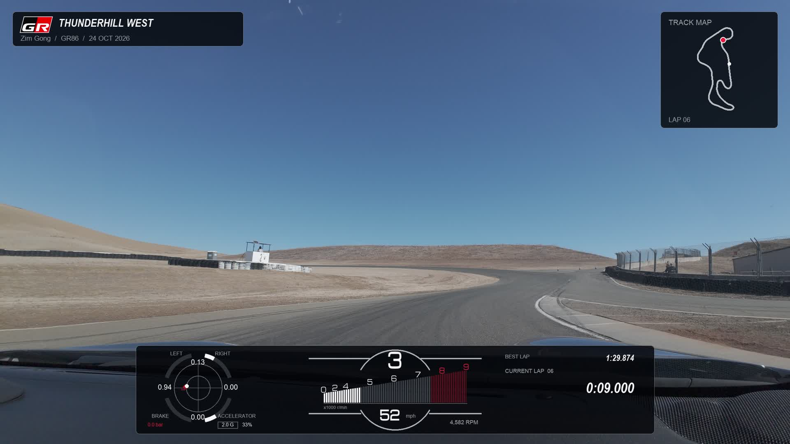

GR86 Track HUD
==============

A GR86 Track-mode-inspired telemetry overlay for a fastest-lap driving video.
Built for Zim Gong's Thunderhill West session: lap 6, **1:29.874**.

Features
--------

* Squared Michroma speed/gear numerals and distinct tachometer segments.
* Speed in mph, RPM, gear, brake pressure, throttle and steering input arcs.
* Lateral/longitudinal G monitor, short G trail, GPS map and lap timer.
* Compact, centered bottom panel, approximately 82 percent opaque.
* Gap-aware telemetry: no interpolation across sample intervals over 0.5 seconds.
* Continuous GPS speed fallback when vehicle speed is unavailable.
* 1080p59.94 output with original engine audio; HUD updates at 29.97 fps.

This is the final session-specific renderer, not a general-purpose editing app.
The original videos, raw XRK file, CSV telemetry and rendered MP4s are excluded.
The preview and session timing constants are included.

Run on macOS
------------

Requires Python 3.10+, FFmpeg with VideoToolbox support, and macOS supplemental
Arial fonts. Michroma is bundled with its SIL Open Font License.

::

   python3 -m venv .venv
   source .venv/bin/activate
   pip install -r requirements.txt
   brew install ffmpeg

Place the original video ``DJI_20261024120038_0061_D.MP4`` in the repository
root, alongside one directory ending in ``_CSV`` containing the exported channels.
Inputs can also be symlinked here. They are ignored by Git.

Channel files have two header rows followed by numeric time/value columns:
``SpeedV.csv``, ``RPM.csv``, ``Gear.csv``, ``Throttle Positio.csv``,
``BrakePress.csv``, ``Clutch.csv``, ``IMU LongG.csv``, ``IMU Lateral G.csv``,
and ``SteerAngle.csv``. Clutch is loaded but not displayed.
``_GPS.csv`` has one header row; columns used are timestamp (0), latitude (2),
longitude (3), and speed in m/s (5). All timestamps are session seconds.
Vehicle speed is km/h; throttle is percent; brake is bar; steering is degrees.

::

   zsh fastest_lap/render_gr86_video.sh

Output: ``fastest_lap/Thunderhill_West_GR86_Track_Mode_1m29.874_refined_1080p60.mp4``.
An intermediate transparent QuickTime overlay is generated under ``fastest_lap/work``.
Expect several hundred MB of output and temporary files.

To render one transparent preview without encoding the video::

   cd fastest_lap/work
   python3 -c 'import render_gr86 as g; g.frame(12).save("preview.png")'

Adapting another session
-----------------------

Edit session timing in ``fastest_lap/work/render.py`` and the source filename,
seek time, duration and output name in ``fastest_lap/render_gr86_video.sh``.
Update the header, lap number and best-lap labels in ``render_gr86.py``.
The shell command explicitly rotates this particular upside-down DJI source;
remove the hflip/vflip filters for an upright source. Do not reuse the sync
offset for a different recording. The CSV folder selection uses the first
``*_CSV`` match, so keep exactly one such folder in the root.

Timing and missing data
-----------------------

The timed lap spans telemetry 804.251–894.125 seconds. Audio/RPM alignment
estimated telemetry time = camera time + 52.375 seconds. The edit includes
three seconds before and after the lap: source 748.876–844.750 seconds.
Independent alignment windows agreed within 0.01 seconds, but practical sync
precision is estimated at 0.05–0.1 seconds, not hardware timecode precision.

The exported vehicle channels contain a roughly 96-second gap ending near
811.44 seconds. Consequently the first 10.2 seconds of this edit use GPS speed;
gear, RPM and vehicle inputs display missing values until samples resume.
Whether the original XRK contains the missing samples was not established.
The renderer deliberately avoids inventing those values.

``sync.py`` and ``refine.py`` preserve the exploratory audio alignment method.
Run from the repository root after extracting mono 8 kHz signed 16-bit PCM
as ``fastest_lap/work/audio.wav``. ``sync.py`` writes ``spectrum.npz``;
``refine.py`` searches a narrow range around this session's known offset.
These research scripts use ordinary interpolation and should only be evaluated
against valid continuous RPM intervals; they do not automatically select laps.

Design and assets
-----------------

The HUD is inspired by Toyota's Track mode and G monitor, with adapted scales:
2 g, 40 bar brake, and +/-180-degree steering. These are editorial choices,
not a claim to reproduce Toyota's display calibration. Gear turns red at
7,400 RPM. The font is a visual approximation, not Toyota's proprietary font.

* Michroma: https://github.com/google/fonts/tree/main/ofl/michroma
  (license: ``fastest_lap/work/Michroma-OFL.txt``).
* GR badge source: https://commons.wikimedia.org/wiki/File:Toyota_Gazoo_Racing_logo.svg
  (cropped raster used in the original edit; Toyota/GR trademarks remain their owners').
* Gauge references: https://manual.toyota.jp/86/2309/cv/ja_JP/contents/vhch02se010402.php
  and https://manual.toyota.jp/86/2309/cv/ja_JP/contents/vhch02se010403.php.

No Toyota affiliation or endorsement. No blanket license is applied to the
repository; the bundled font retains its separate license.
